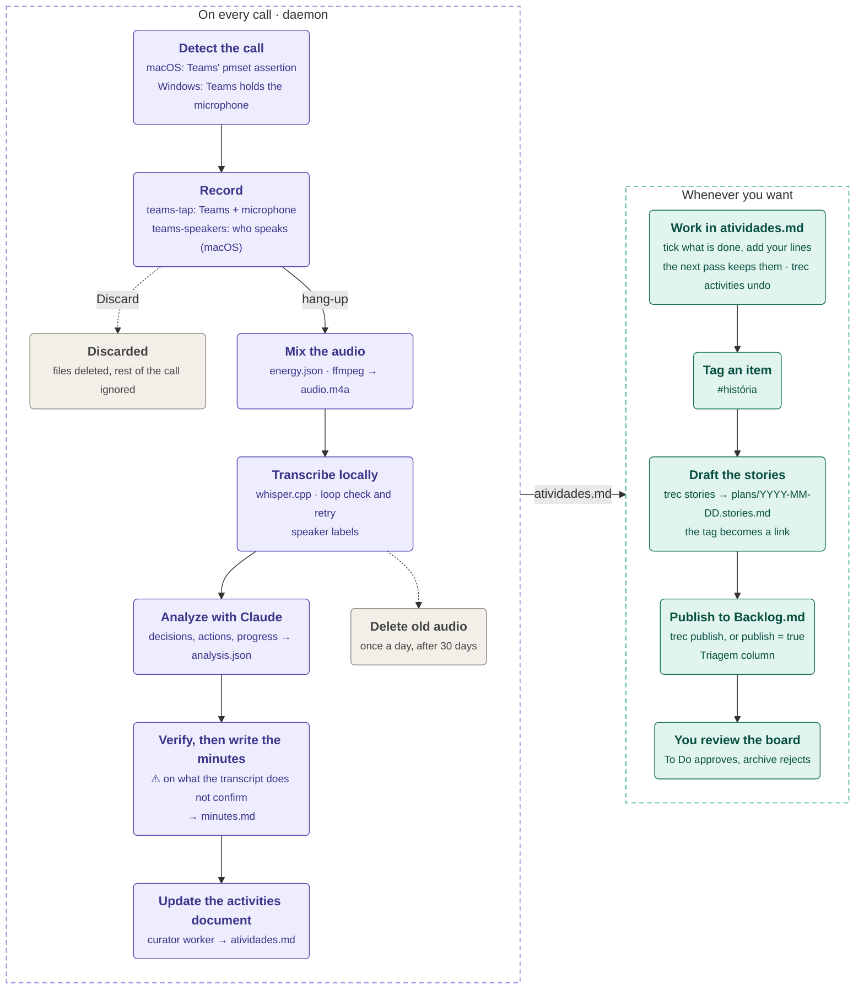
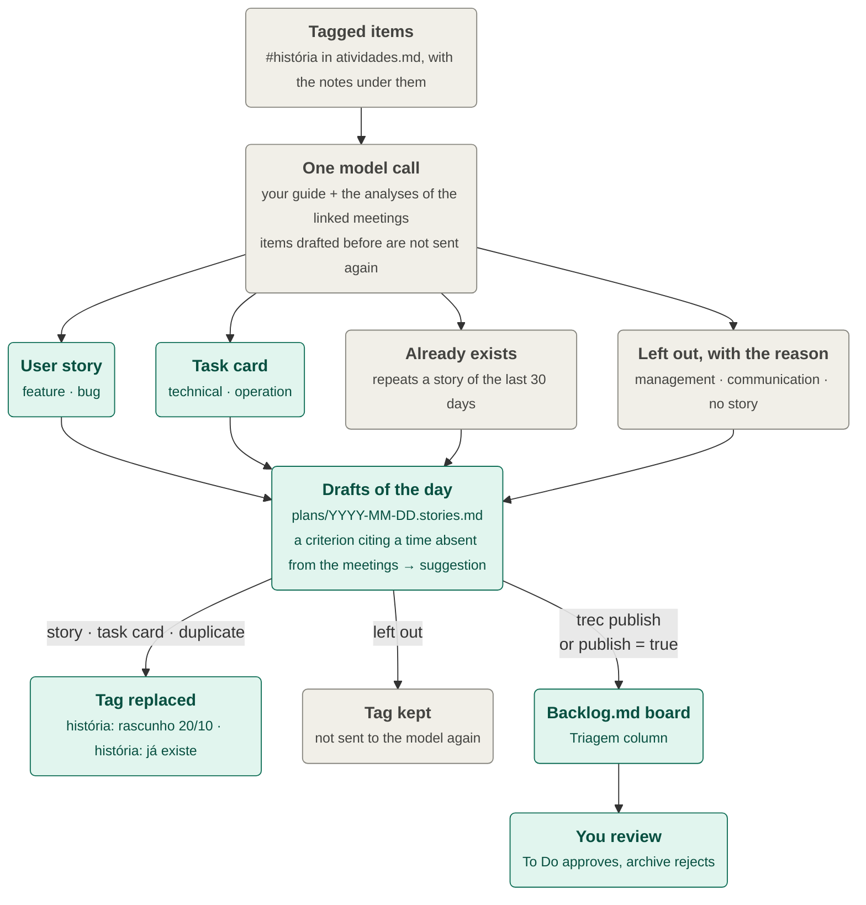

# teams-recorder

A background tool for macOS (and Windows, not yet run on real hardware) that notices when a Microsoft Teams call starts, records Teams audio and your microphone, transcribes the call locally with whisper.cpp, and uses Claude to pull out decisions, actions and deadlines. After each analyzed meeting an agent keeps one document, `data/activities/atividades.md`, current with everything still open for you (see [Activities document](#activities-document)). When you tag an item of that document `#história`, `trec stories` drafts a user story for your backlog from it.

It is built for one person who sits in several meetings a day and wants a reliable record of what they committed to, without taking notes. Meetings are expected in Brazilian Portuguese, so the minutes, the activities document and the stories it writes are in Portuguese. The code, CLI and documentation are in English.

See the [flowchart](#how-it-works) for the whole pipeline.

## Key features

- **Automatic recording.** A daemon watches Teams and starts recording about 1–2 s after a call begins. It stops about 5 s after you hang up. A dialog lets you discard any recording.
- **Two aligned tracks.** Teams audio is captured through a Core Audio process tap and the microphone separately. The tracks are aligned to the call's start, then mixed with noise reduction and loudness normalization.
- **Local transcription.** whisper.cpp (`large-v3-turbo-q5_0`, 574 MB) runs on your Mac. Audio never leaves the machine.
- **Speaker labels (macOS).** A second helper reads who is speaking from the Teams meeting window, and your own lines are told apart from the microphone track. Transcript lines carry the person's name, and the analysis takes owners and participants from them. No voice is modelled. See [Speaker labels](#speaker-labels).
- **Structured analysis.** Claude extracts the summary, topics, decisions, your actions, other people's actions, deadlines, risks and open questions. Every item carries the transcript timestamp where it was said.
- **Meeting minutes.** A `minutes.md` file is written for each meeting, with no extra model call, including what the meeting said about earlier work (finished, blocked, a new date).
- **Activities document.** A curator agent updates one Markdown file after each analyzed meeting: your open actions, what you wait on from others, dates and recent context, every line linked to its meeting. It suggests (💬) what the meetings said is done, but only you tick or untick; it keeps your edits, archives instead of deleting, and `trec activities undo` restores the last pass.
- **User stories on demand.** You tag an item of the activities document `#história` and run `trec stories`. A feature or a bug becomes a user story written by your own guide, technical and operation work becomes a task card, and anything else is left out with the reason. The tag turns into a link to the draft. Drafts are published to a local Backlog.md board for review.
- **Two ways to pay for the model.** Use the Claude API with prepaid credit (about US$ 0.10 per hour of meeting), or your Claude Code subscription.
- **No database.** A meeting's state is the set of files in its folder, so any step can be re-run, and one meeting's failure never blocks the others.

## Table of contents

- [How it works](#how-it-works)
- [Tech stack](#tech-stack)
- [Prerequisites](#prerequisites)
- [Installation on macOS](#installation-on-macos)
- [Installation on Windows](#installation-on-windows)
- [First run checklist](#first-run-checklist)
- [Daily use](#daily-use)
- [Command reference](#command-reference)
- [Recording in detail](#recording-in-detail)
- [Transcription](#transcription)
- [Speaker labels](#speaker-labels)
- [Analysis with Claude](#analysis-with-claude)
- [Activities document](#activities-document)
- [User stories and the Backlog.md board](#user-stories-and-the-backlogmd-board)
- [Configuration](#configuration)
- [Data, privacy and retention](#data-privacy-and-retention)
- [Architecture](#architecture)
- [Development](#development)
- [Troubleshooting](#troubleshooting)
- [Project status](#project-status)
- [Further documentation](#further-documentation)
- [License](#license)

## How it works



1. **Detect.** Every second the daemon reads `pmset -g assertions`. While Teams is in a call, it holds a "prevent sleep" assertion, and that is the signal. On Windows, the signal is Teams holding the microphone, as recorded by the privacy indicator in the registry.
2. **Record.** Recording starts on the first positive reading. `teams-tap` (a small Swift binary) writes Teams audio to `tap.wav` and the microphone to `mic.wav`. On macOS, `teams-speakers` (a second Swift binary) also watches the Teams meeting window and writes who speaks when to `speakers.jsonl`. A dialog asks whether to keep the recording; recording does not wait for the answer.
3. **Mix.** After hang-up, the level of each raw track is saved to `energy.json`, then ffmpeg cleans each track (80 Hz high-pass, noise reduction), mixes them, normalizes to -18 LUFS and writes `audio.m4a`. The raw tracks are deleted.
4. **Transcribe.** whisper.cpp writes `transcript.json` and `transcript.txt` (`[hh:mm:ss] text`, or `[hh:mm:ss] Name: text` for a line whose speaker is known). A transcript caught in a hallucination loop is transcribed once more (see [Transcription](#transcription)).
5. **Analyze and verify.** The transcript text is sent to Claude with a JSON schema. A second call checks every claim against the transcript and marks what it cannot confirm. The result is saved as `analysis.json` and rendered to `minutes.md`.
6. **Curate.** Right after the analysis is saved, the daemon's curator worker updates `activities/atividades.md` with what the meeting added, suggested or changed. It never blocks the steps above, and a failure only writes `curation_error.txt` in the meeting folder.
7. **Draft and publish stories.** Nothing here is scheduled. When you tag items of `atividades.md` with `#história` and run `trec stories`, a story is drafted for each one into `plans/YYYY-MM-DD.stories.md`, and the tag becomes a link to it. With `[stories] publish = true` the drafts are also sent to the **Triagem** column of a Backlog.md board; otherwise `trec publish` sends them.

Steps 3–6 run in the background, so a call that starts right after another one is still recorded. A step that fails writes `error.txt` in the meeting folder and stops only that meeting; re-running resumes from there. Every step can also be run by hand with `trec`. Once a day the daemon also deletes the `audio.m4a` of transcribed meetings older than `[audio] retention_days` (30).

## Tech stack

| Layer | Technology |
|---|---|
| Orchestration | Python 3.11+ (Typer CLI, Pydantic, python-dotenv), hexagonal architecture |
| Audio capture (macOS) | Swift binary `native/teams-tap`: Core Audio Process Tap (macOS 14.2+) and AVAudioEngine for the microphone |
| Speaker labels (macOS) | Swift binary `native/teams-speakers`: reads the Teams window through the Accessibility API (read-only), started by the daemon as its own launchd job |
| Audio capture (Windows) | C# binary `native/teams-tap-win`: WASAPI process loopback (.NET 8) |
| Mixing and conversion | ffmpeg |
| Transcription | whisper.cpp (`whisper-cli`), ggml models from Hugging Face, optional Silero VAD |
| Analysis, activities curator, stories | Claude Opus 5.5 (`claude-opus-5-5`) through the `anthropic` SDK, or Claude Code headless (`claude -p`) |
| Background service | launchd LaunchAgents (macOS), Task Scheduler (Windows) |
| Story board | [Backlog.md](https://github.com/MrLesk/Backlog.md) (local Markdown kanban) |
| Tests and types | pytest, pytest-cov, mypy |

## Prerequisites

**macOS**

- macOS 14.2 or later (needed for Core Audio process taps)
- [Homebrew](https://brew.sh)
- Xcode Command Line Tools (the installer asks for them if they are missing)
- Microsoft Teams (the new client, process `MSTeams`)
- About 1 GB of disk for the model and tools, plus about 1 GB per hour of meeting while a call is recorded (raw tracks are deleted after mixing)
- For analysis, **one** of:
  - a Claude API key ([console.anthropic.com](https://console.anthropic.com)) for the `api` provider, or
  - [Claude Code](https://claude.com/claude-code) installed and logged in, for the `claude-code` provider
- Optional: [Backlog.md](https://github.com/MrLesk/Backlog.md) (`brew install backlog-md`) to publish stories

**Windows**: Windows 10 version 2004 or later, or Windows 11, with winget. See [Installation on Windows](#installation-on-windows).

> **Important:** keep the project out of `~/Documents`, `~/Desktop`, `~/Downloads` and iCloud Drive. macOS privacy controls (TCC) block background processes there, first now and then and later all the time ("Resource deadlock avoided"). The installer refuses to run in those folders. On Windows, keep it out of OneDrive.

## Installation on macOS

```bash
git clone https://github.com/felipmateus/meet-record.git ~/Projetos/teams-recorder
```

```bash
~/Projetos/teams-recorder/scripts/install.sh
```

Or double-click `install.command` in Finder. The installer is idempotent: run it again at any time and it only does what is missing.

What it does:

1. Checks macOS, the project location and whether Teams is installed.
2. Installs `ffmpeg` and `whisper-cpp` with Homebrew, and asks for the Xcode Command Line Tools if they are missing.
3. Creates `.venv` with Python 3.11 or later (installing `python@3.12` if needed) and installs the package.
4. Builds `teams-tap` and `teams-speakers` (`scripts/build-native.sh`).
5. Asks for your name and the LLM provider, and writes them to `config.toml`. With the `api` provider it creates `.env` with permission 600 for the key.
6. Downloads the whisper model (574 MB) into the models folder.
7. Runs `trec doctor`.
8. Installs the daemon as a LaunchAgent (and removes the daily planner job an older version installed). It skips this while a recording is in progress, and asks before taking over services that run another copy of the project.
9. Explains the three macOS permissions (Microphone, Screen & System Audio Recording, Accessibility) and can open their settings pages. The Accessibility entry has to be added by hand, see the [first run checklist](#first-run-checklist).

| Option | Effect |
|---|---|
| `--name "Your name"` | Sets `[user] name` without asking |
| `--provider claude-code\|api` | Sets `[llm] provider` without asking |
| `--skip-model` | Does not download the whisper model |
| `--no-agent` | Does not install the LaunchAgents |
| `--yes` | Asks nothing; keeps current settings and installs the services |
| `--dry-run` | Shows what it would do and changes nothing |

Installing Homebrew, logging in to Claude Code and granting macOS permissions need your password or browser, so they are left to you.

**Uninstall.** `scripts/uninstall.sh` removes this copy's LaunchAgents (the daemon, and the planner job an older version installed). `--all` also deletes `.venv` and the `teams-tap` build (not yet the `teams-speakers` build); `--yes` asks nothing. Recordings, transcripts, the activities document, story drafts and models are never deleted.

### Manual installation

If you prefer to do the installer's steps yourself:

```bash
brew install ffmpeg whisper-cpp
python3 -m venv .venv && source .venv/bin/activate
pip install -e ".[dev]"
scripts/build-native.sh                 # → native/teams-tap/.build/release/teams-tap and native/teams-speakers/.build/release/teams-speakers
scripts/download-model.sh               # → data/models/ggml-large-v3-turbo-q5_0.bin
cp .env.example .env && chmod 600 .env  # only for the api provider; paste the key
trec doctor
trec agent install
```

## Installation on Windows

> The Windows port is built and unit-tested on macOS but **has not run on a Windows PC yet**.

Install from a clone outside OneDrive, in PowerShell:

```powershell
git clone https://github.com/felipmateus/meet-record.git C:\Projetos\teams-recorder
C:\Projetos\teams-recorder\scripts\install.ps1
```

Or double-click `install.cmd`. The installer installs with winget only what is missing: Python 3.12, ffmpeg and, when `teams-tap.exe` must be built, the .NET 8 SDK (a .NET runtime alone cannot build it), so a PC that already has them needs no winget. It downloads whisper.cpp from a pinned release (checked by SHA-256) into `tools\whisper` and the model into `data\models` (`scripts\download-model.ps1`), then installs the daemon's scheduled task and removes the planner task an older version installed. Options mirror the macOS installer: `-Name`, `-Provider`, `-SkipModel`, `-NoAgent`, `-Yes`, `-DryRun`; `-NoActivities` also sets `[activities] enabled = false`, and `-RetentionDays N` sets `[audio] retention_days`. `scripts\uninstall.ps1` removes the tasks; `-All` also removes `.venv` and the build.

Only the parts that talk to the operating system differ:

| Part | macOS | Windows |
|---|---|---|
| Teams audio and microphone | `teams-tap` (Swift, Core Audio) | `teams-tap.exe` (C#, WASAPI), stopped through a stop file |
| Speaker labels from the Teams window | `teams-speakers` (Swift, Accessibility API) | Not available yet; your own lines are still labelled from the two tracks |
| Call detection | Teams' power assertion in `pmset` | Teams holding the microphone (registry `ConsentStore\microphone`) |
| Background service | LaunchAgents | Task Scheduler task `\teams-recorder\daemon` (at logon) |
| Notifications | Notification Center | Toasts, shown under "Windows PowerShell" |
| Keep-or-discard question | Dialog on the main screen | Message box, always on top: Yes keeps, No discards |

Windows asks for no permission to capture Teams audio. The microphone needs "Let desktop apps access your microphone" under Settings > Privacy & security > Microphone. `audio.teams_process_name_windows` (default `ms-teams.exe`) names the Teams process; `audio.mic_backend` applies only to macOS.

## First run checklist

1. **`trec doctor` is all `ok`.** It checks ffmpeg, whisper-cli, swift, osascript, the `teams-tap` build, Claude Code or the API key, the models, the transcript-loop guard, the claim verifier, the speaker labels, the activities document, the `.env` permission, free disk, the story guide and each story destination. It exits 0 only when everything your configuration needs is present. The `speaker labels` line is information only and never fails the doctor: it says whether `teams-speakers` is built and whether it holds the Accessibility permission (the check runs the helper as its own short-lived launchd job, the same context the daemon uses), and how the last recording was labelled.
2. **Grant the three macOS permissions** under System Settings > Privacy & Security. The first two are requested on the first recording; the third is not requested by macOS, you add it by hand:
   - **Microphone**, for the process that records the microphone.
   - **Screen & System Audio Recording**, for `teams-tap`. Without it, the Teams track comes out silent and only your voice is recorded.
   - **Accessibility**, for `teams-speakers`, so it can read the Teams window. Open the Accessibility pane, press the **+** button, press Cmd+Shift+G, enter `<project>/native/teams-speakers/.build/release/teams-speakers`, choose Open and switch the entry on. A request made by a background job creates no entry, so the **+** button is the only way. The grant has to be on the helper itself: the daemon runs it as its own launchd job (`local.teams-recorder.speakers`), so granting your terminal or Python does not cover it. macOS ties the grant to the binary, so a rebuild (`scripts/build-native.sh`) may require adding it again; `trec doctor` tells. Without it recordings work as before, only without names (see [Speaker labels](#speaker-labels)).
3. **Set your name** in `config.toml` (`[user] name`), as people say it in meetings, so tasks addressed to you by name are attributed to you.
4. **Check that the detector sees a call.** Join a test call and run `trec daemon --once`. It should report Teams in a call along with its PID.
5. **Check the services** with `trec agent status`. After an update that adds the speaker labels or the activities curator, run `trec agent restart` so the daemon starts using them.

## Daily use

Once installed, there is nothing to do: join Teams calls as usual.

- When a call starts, you get a notification and a **Keep recording / Discard** dialog. Press Return, or ignore it, to keep the recording.
- After hang-up, the meeting is mixed, transcribed and analyzed in the background. The minutes land in `data/recordings/<id>/minutes.md`, and a few minutes later `data/activities/atividades.md` is updated (a notification says so when something of yours changed). Open it with `trec activities --open`, tick what is done, add your own lines; the next update respects them.
- To turn an item into a user story, add `#história` to its line in `atividades.md` and run `trec stories`: the draft lands in `data/plans/YYYY-MM-DD.stories.md` and the tag becomes a link to it.
- Once a day the daemon deletes the audio of transcribed meetings older than `[audio] retention_days` (30).
- `trec status` shows every meeting and its state, the recording in progress, the activities summary and the stories waiting to be published.

## Command reference

`trec --help` and `trec <command> --help` list everything. All commands work from any terminal with the venv active (`source .venv/bin/activate`).

| Command | What it does |
|---|---|
| `trec status` | Data folder, API key status, meetings with state and next step (and the share of labelled lines, `· speakers 78%`), degraded transcripts, unconfirmed claims, recording in progress, the activities summary (`Activities: 7 yours · 3 waiting on others (last pass …)`), stories waiting to be published |
| `trec doctor` | Checks dependencies, models, the transcript-loop guard, the claim verifier, the speaker labels (helper build and Accessibility permission), the activities document (information only), permissions, disk and story destinations |
| `trec start [--pid N] [--title T]` | Starts a manual recording (Teams must be running, or pass `--pid`); prints a `Speakers:` line when the observer started |
| `trec stop` | Stops the recording, mixes the tracks and writes `audio.m4a`. Works from any terminal |
| `trec cancel` | Discards the recording in progress and deletes its files |
| `trec transcribe [id]` | Transcribes one meeting, or all meetings in state `recorded`, and prints how many lines got a speaker label, or why none did |
| `trec analyze [id]` | Analyzes one meeting, or all meetings in state `transcribed`, writes `minutes.md`, then updates the activities document for the meetings it analyzed (skipped with `[activities] enabled = false`) |
| `trec minutes [id] [--all]` | Re-renders `minutes.md` from existing analyses, with no model call |
| `trec activities [--open]` | Where the activities document stands: path, last update, the focus, counts, the last pass and the meetings not curated yet with their retry command; `--open` also opens the file |
| `trec activities curate <id>… \| --since YYYY-MM-DD [--yes]` | Reruns the curator for analyzed meetings, or builds the document from the meetings since a date (asks first: meetings, passes, estimated time) |
| `trec activities undo [--yes]` | Shows the last pass and what undoing it changes, then restores the document to before it |
| `trec stories` | Drafts a user story for each item of the activities document tagged `#história` and replaces the tag with a link to the draft; with `[stories] publish = true` it also publishes today's drafts |
| `trec publish [--date YYYY-MM-DD] [--only 1,3]` | Sends a day's drafts (default today) to the configured boards, skipping what is already there |
| `trec purge` | Deletes `audio.m4a` from transcribed meetings older than `audio.retention_days` (the daemon also does it once a day) |
| `trec daemon [--once]` | Runs the detector loop (used by the LaunchAgent); `--once` is a single diagnostic reading |
| `trec agent install [--env K=V]` | Installs the daemon as a service (starts at login, restarts on a crash) and removes the daily planner job an older version installed; `--env` is macOS only |
| `trec agent status \| restart \| uninstall` | Inspects, restarts or removes the service (`restart` and `uninstall` also remove the old planner job when it is still there) |
| `trec version` | Prints the version |

Processing commands without an id act on every pending meeting and keep going when one fails. They exit with code 1 if any failed. Errors are written to `error.txt` in the meeting folder, and re-running clears them.

## Recording in detail

### Manual recording

```bash
trec start --title "Daily"   # Teams must be open; or use --pid
trec status                  # shows the recording in progress
trec stop                    # mixes into data/recordings/<id>/audio.m4a
```

Only one recording runs at a time, manual or automatic. The daemon adopts a manual recording that is already running instead of starting a second one. Recordings started with `trec start` are not asked about.

### Keep or discard

When the daemon starts a recording, a dialog opens centered on the main screen, above other windows, with **Keep recording** (the default, chosen with Return) and **Discard**.

- Recording starts before the answer, so the beginning of the meeting is never lost.
- **Discard** stops the recording, deletes its files and ignores the rest of that call. The next call is asked again.
- No answer within 30 seconds keeps the recording. If the dialog cannot be shown, the recording is also kept.
- If the call ends while the dialog is open, the capture stops at hang-up and transcription waits for the answer.

Configure it under `[confirmation]`: `enabled = false` turns the question off, and `timeout_seconds` sets the wait. If Teams is in full screen, the dialog may appear on another desktop.

### Tracks, alignment and mixing

- `teams-tap --pid` captures Teams: the main process and the helper processes that actually emit audio, since Teams' main process emits none. `teams-tap --mic default` records the microphone through AVAudioEngine. It follows the system default input (so it switches to a headset) and survives the reconfiguration Teams performs when it opens the microphone. `teams-tap --list` shows the current audio clients.
- Both tracks share the meeting start as their epoch. Every buffer is placed at its Core Audio timestamp, and missing time is written as silence, so the tracks keep the real call length and stay in sync. Each gap is logged in `data/log/capture.log` as `gap of X s at Y s`.
- On macOS the daemon also starts `teams-speakers` right after the two recorders, as its own launchd job (`local.teams-recorder.speakers`, definition in `<data_dir>/run/`), and stops it with them. It never blocks a recording: when the helper is not built, lacks the Accessibility permission or fails to start, the recording goes on and one line saying why is written to `speakers.jsonl`. `trec start` prints a `Speakers:` line when it started, or why it did not. See [Speaker labels](#speaker-labels).
- Raw tracks are 16-bit WAV (about 1 GB per hour). `audio.bit_depth = 32` records 32-bit float instead (about 2 GB per hour), with no gain for transcription.
- When the call ends, the recorders stop at once and the "recording in progress" marker is released. Before mixing, the level of each raw track per 100 ms is saved to `energy.json` (the tracks are gone afterwards); a failure is logged and mixing goes on. Mixing writes `audio.partial.m4a` and renames it only on success, with a time limit of twice the meeting length (at least 10 minutes). If mixing fails or the daemon stops first, the raw tracks stay and the next daemon start mixes them again.
- A track that is missing or under 1 KB is dropped, and the mix uses the other one. If one track is shorter than half the other, raw copies are kept in `<meeting>/debug/` for diagnosis.
- A notification warns when a recording starts with room for less than 2 hours, and again during a call if less than 1 GB is left.
- If the daemon crashes during a recording, it finalizes the orphaned recording when it starts again and resumes stalled meetings.

The ffmpeg microphone backend is still available (`audio.mic_backend = "ffmpeg"`), but it stops recording a few seconds after Teams opens the microphone.

## Transcription

```bash
trec transcribe                      # every recorded meeting not yet transcribed
trec transcribe 2026-10-06_14-00-00  # one meeting
```

The M4A is converted to 16 kHz mono WAV and passed to `whisper-cli` with the language fixed to `pt` and no text context between windows (`-mc 0`). The output is `transcript.json` (segments with start, end and text, plus the transcript's health) and `transcript.txt`. On a MacBook Air M1, long meetings transcribe at about a quarter of their length.

**Hallucination loops.** On long audio whisper can get stuck repeating one line: in an 86-minute meeting held largely in English, "A CIDADE NO BRASIL" filled 70% of the transcript and the first 59 minutes had no usable text. `-mc 0` (`transcription.max_context = 0`) stops a loop from carrying over and leaves Portuguese accuracy unchanged. After whisper, a health check measures the share of segments in repetition loops (the same text 5+ times within 30 consecutive segments) and the minutes that have speech text:

- Above `transcription.max_loop_share` (10%), the transcript is **degraded** and is transcribed once more with `-mc 0` and Silero VAD (about 30% slower). A pass that is not degraded is kept when it has at least 85% of the other's minutes of text; otherwise the one with more text, so a retry that loses more than 15% of the text, an empty one included, never replaces the first pass. A Teams track recorded at the wrong sample rate gets no retry, since VAD cannot repair it.
- If it is still degraded, it is saved anyway and the analysis runs on it. You get a "Degraded transcript" notification with the time ranges that have no text, `minutes.md` opens with a warning banner, and `trec status` marks the meeting.
- `trec transcribe` prints a health line for each meeting, and `trec doctor` shows whether the retry is on.
- If the Teams track itself was recorded at the wrong sample rate (more than 5% of it padded with short silences; it happened with a Bluetooth headset in a call before 2026-10-14), the transcript is flagged instead: a "Teams audio recorded at the wrong rate" notification, a banner in `minutes.md`, and a mark in `trec status`. `scripts/recover-rate-mismatch.sh <meeting folder>` writes an `audio.recovered.m4a` with the remote speech back at its normal speed (see the script for its limits).

Voice activity detection (Silero) is off on the first pass. In a test with short sentences it cut off speech, and the noise reduction in the mix is what improved the text. The installer downloads the VAD model for the retry; to use VAD on every pass, set `transcription.vad = true`.

## Speaker labels

On macOS every line of a transcript can carry the name of the person who said it, with no voice model and no enrolment: the names come from the Teams window itself, and your own lines come from the two tracks.

- **Remote participants.** During a recording `teams-speakers` reads the Teams meeting windows (the main window and the compact view Teams keeps on top when the meeting loses focus) through the macOS Accessibility API, twice per second. A participant's tile shows a frame while they speak. The helper writes each change with the display name to `speakers.jsonl`, together with the names seen (the roster), your own tile's name and the meeting subject from the window title. It is read-only: it sets no accessibility attribute and never focuses, moves or clicks anything in Teams.
- **Your lines.** The tile of yourself has no frame, so your lines come from `energy.json`: a line is yours when no remote turn covers at least 30% of it, the microphone is at least 6 dB louder than the Teams track over it and above -50 dBFS. Remote speech leaking from your speakers into the microphone is louder on the Teams track, so it does not fool the comparison. This part works without the Accessibility permission, and also with `[speakers] enabled = false`.
- **Labelling.** At transcription each speech line takes the remote participant whose speaking turns cover at least 30% of it (the largest overlap wins); else yourself, as `[user] name`, else your own tile's name, else "Você"; else no label. `transcript.txt` shows `[00:03:12] Lucas Huguenin Gurgel de Moura: então eu subo o ambiente até quarta`; unlabelled lines are unchanged. `transcript.json` gains `speaker` on labelled segments and a `speakers` summary (roster, your label, lines labelled out of eligible, and the reason when none was). Transcripts made before this feature load as before. `trec transcribe <id>` redoes the transcript and its labels while `audio.m4a` still exists; `speakers.jsonl` and `energy.json` stay with the meeting.
- **Downstream.** The analysis and the claim verifier receive the labelled lines, the roster and which label is yours. A labelled line's commitment belongs to the person named (to `usuário` when the label is yours); the first-person heuristic applies only to unlabelled lines. When the roster was read, `participants` is that list. A recording with no title takes the meeting subject from the window (a `--title` wins).
- **Fail-soft.** The labels are optional. A missing helper, a missing permission, no Teams window, a crashed helper or a covered window never fail a recording or a step: the lines stay unlabelled and `trec transcribe`, `trec status` and `trec doctor` say why (see Troubleshooting). The first meeting of a day with no labels at all for a reason you can act on raises one "Speaker labels unavailable" notification; later ones that day only log. Everything stays on the Mac.

**What it needs from you**
- **Accessibility permission for `teams-speakers`**, added by hand (see the [first run checklist](#first-run-checklist)), and `trec agent restart` once, so the daemon loads the feature.
- **A Teams window that is rendered.** Chromium stops updating the accessibility tree of a window that is fully covered by another one, so while no Teams window is visible nobody is detected and only your own lines are labelled. The compact view counts: Teams keeps it on top when the meeting window loses focus, so working in another app does not hide it.
- **Labels are Teams' display names**, as shown on the tiles (a guest keeps the suffix Teams shows, for example `teste Não verificado`).

**Testing it.** A tile exists per participant, and the same account on two devices is one participant: joining from your phone with your own account gives the phone no tile. Join the test meeting as someone else, for example from the phone as a guest ("join as a guest" with another name), talk in bursts with yourself muted on the Mac, and check `trec transcribe` and the transcript afterwards.

`teams-speakers --check` reports the permission of the process that macOS holds responsible *where it runs*: typed in a terminal it reports the terminal's grant, not the daemon's. `trec doctor` runs the same check as a launchd job, which is the context that matters. Run by hand, `--verbose` logs every pass's element count and duration. Under the daemon the helper's log is `data/log/speakers.log`.

Design and measurements: [`docs/SPEAKER-ATTRIBUTION.md`](docs/SPEAKER-ATTRIBUTION.md) (investigation and the eight probe runs), `docs/tasks/speaker-attribution/prd.md` and `docs/tasks/speaker-attribution/` (specification, ADRs).

## Analysis with Claude

```bash
trec analyze                         # every transcribed meeting not yet analyzed
trec analyze 2026-10-06_14-00-00     # one meeting
```

The model returns a schema-validated record:

| Field | Content |
|---|---|
| `title`, `purpose`, `meeting_type` | Inferred title (names untitled automatic recordings), why the meeting happened, and its type (`standup`, `client`, `project_review`, `one_on_one`, `other`) |
| `participants`, `summary`, `topics` | People who speak or are addressed (not people only talked about), or the roster read from the Teams window when there is one; 3–6 sentence summary, topics with key points |
| `decisions` | Only what was actually decided, with timestamp |
| `my_actions`, `others_actions` | Description, owner, ISO due date, priority (only when urgency was stated), timestamp, and **kind** |
| `status_updates` | What the meeting said about work that already existed: `about`, `change` (`done`, `in_progress`, `blocked`, `delayed`, `due_changed`, `reassigned`, `cancelled`), `who`, the literal quote (at most 20 words, hedges kept), timestamp, and the new date or owner when said |
| `deadlines`, `open_questions`, `next_meetings`, `risks` | Relative dates are resolved against the meeting date |

An action also carries `for_whom` when the meeting said who waits for the result. An intention ("vou subir") is never progress, and a hedge ("acho que já enviei") is never recorded as `done`. Each action also carries a kind (`feature`, `bug`, `technical`, `operation`, `management`, `communication`), kept in `analysis.json`; nothing routes by it since the planner was removed, and the story writer decides the kind of a story from the item you tagged. The rules are in `prompts/analyze_system.md`.

`minutes.md` follows the structure of the `meeting-notes` skill: title, date, participants, type and purpose, summary, topics, decisions, an action table (owner, due date, priority, timestamp), a `🔄 Andamento informado` section with the status updates, risks, open questions and next steps.

Safeguards:

- Transcripts under 20 words are not sent to the model, because whisper hallucinates on silence. They get a local "transcript too short" analysis instead.
- Refusals, truncated responses and schema violations are errors. A partial analysis is never saved.
- The model is told not to invent tasks, deadlines or decisions, to name another person as owner only when the transcript makes it evident (else `indefinido`), not to record tentative statements as decisions, and to keep sensitive personal data (health and private life, for example; the list is in `prompts/analyze_system.md`) out of every field.
- **Claim verification** (`[verification]`, on by default): one more call, Sonnet at medium effort on the same provider, checks every decision, action, deadline, status update and participant against the transcript. What it cannot confirm is kept and marked "⚠️ _a confirmar: <motivo>_" in `minutes.md`, and the story writer never cites it as the source of a criterion. Two checks in code also mark claims with sensitive personal data and participants who neither speak nor are addressed. A failed call leaves the claims unverified and never blocks the analysis. A degraded transcript, or one from a Teams track recorded at the wrong sample rate, is not checked: the verifier would confirm the hallucinations the analysis took from it. Its banners in `minutes.md` and the story drafts say so. `enabled = false` turns off the call; the two code checks still run.
- Every call logs tokens (and cost, or its equivalent) to `data/log/llm_usage.jsonl`; verifier calls are tagged `verify:<meeting>`.

### Provider: API or Claude Code

`llm.provider` in `config.toml` selects the transport. The same provider serves the analysis, the claim verifier, the activities curator and the stories.

| `provider` | Uses | Billing | Notes |
|---|---|---|---|
| `api` (default when unset) | Claude API with `ANTHROPIC_API_KEY` from `.env` | Prepaid credit, about US$ 0.10 per hour of meeting | Cached system prompt, server-side fallback for occasional safety-classifier refusals |
| `claude-code` | Claude Code in headless mode (`claude -p`) | Your Claude Code subscription | Needs a logged-in session on the Mac; no refusal fallback; model alias in `llm.cli_model` |

`TREC_LLM_PROVIDER` overrides the file, for example `TREC_LLM_PROVIDER=claude-code trec analyze`. To set it for the daemon, run `trec agent install --env TREC_LLM_PROVIDER=claude-code`.

## Activities document

> This document replaced the daily plan: on 2026-10-20 the 6 pm planner and `trec plan` were removed. Old plans in `data/plans/` and `open_actions.json` stay on disk, unread.

After each analyzed meeting, one Claude call (the curator, `prompts/curate_system.md`) updates `data/activities/atividades.md`. It receives the current document, the new analyses, transcript excerpts around each progress statement, a 14-day calendar, what you edited since its last pass and the recent archive. It answers with edits to the file plus a focus, a one-line summary and whether to notify you. Up to four meetings that finished together are curated in one pass.

```bash
trec activities curate --since 2026-10-05   # once: build the document from past meetings (asks first)
trec activities --open                      # focus, counts, last pass, meetings not curated; opens the file
trec activities undo                        # restore the document to before the last pass
```

The document (in Brazilian Portuguese) has a box rewritten on every pass (update time and the three to five lines of focus), then `## Minhas ações`, `## Aguardando outros`, `## Agenda e prazos`, `## Contexto recente`, and a generated link block. Each item links to its meeting's `minutes.md`. Three markers: 💬 a suggestion about something a meeting said (never an automatic change), ⚠️ not confirmed, 💤 not mentioned for about three weeks.

- **Only you close an item.** A meeting that says something is done adds a 💬 sub-line with the quote; you tick it. The one code rule: only an archive (with a reason) removes a checkbox line, and no edit ticks or unticks one.
- **Your edits stand.** Lines you wrote or changed are never reworded, moved or archived; a meeting that mentions one adds a sub-line. A line you delete is archived as `removido por você`. A line you type inside the box is moved to the right section. Edits made while a pass runs are kept (the curator's edits are applied to the file as it is when the answer arrives) and are read at the next pass.
- **Nothing is deleted.** What leaves goes to `data/activities/arquivo/YYYY-MM.md` with its date and reason: items you ticked before the previous working day, past agenda entries, answered context lines, duplicates. Versions of the last 50 passes are kept for `trec activities undo`, which previews the change and asks first.
- **Failures are retried.** A failed pass leaves the document untouched, writes `curation_error.txt` in the meeting folder, notifies you and is retried by the daemon (at most twice for a meeting curated alone). `trec activities` lists every meeting analyzed in the last 10 working days with no successful pass and the command to rerun it.
- **Settings.** `[activities]` in `config.toml`: `enabled` (`false` turns off only the automatic updates; the `trec activities` commands still work), `model`, `cli_model`, `effort`, `notify`, `keep_versions`. The project and its `data/` must stay out of iCloud, Documents and Desktop, as for every file the daemon writes.

The daemon runs the curator in a thread, so it needs `trec agent restart` after this feature is installed. To get a user story from an item, tag it `#história` (see [User stories](#user-stories-and-the-backlogmd-board)). The file layout is under [Data layout](#data-layout); the product page is [`docs/prd/pages/09-activities.md`](docs/prd/pages/09-activities.md).

## User stories and the Backlog.md board

### Drafting

Stories are drafted on demand, only for items you ask for. Add `#história` to an item of `data/activities/atividades.md` (the notes you write under it, indented, come with it), then run:

```bash
trec stories     # a draft for every tagged item → data/plans/YYYY-MM-DD.stories.md
```



- One model call writes the drafts of all the new tagged items, by the rules of your guide (`[stories] guide`, default `prompts/user_story_guide.md`). Edit that file to change how stories are written; it is re-read on every call. The call also sees the analyses of the meetings the items link to.
- The model sets each story's kind from the item: `feature` and `bug` become user stories, `technical` and `operation` become task cards with only the short title and details. Anything else (management, communication, a follow-up) is not drafted and is listed with a reason. It sets priority and due date only when the item or its meetings stated one.
- When it finishes, the tag is replaced by a link (`história: [rascunho 20/10](../plans/2026-10-20.stories.md)`), or by `história: já existe ("<title>")` when the item repeats a story of the previous `dedup_days` days (default 30). An item the model left out keeps its tag, and running `trec stories` again does not send it to the model a second time.
- The command never waits for a curator pass: if one is running, the tags are replaced by the next `trec stories`. A line you edited meanwhile keeps its tag. Running it with nothing tagged says so and calls no model.
- The code keeps traceability: a story may only cite an item it received, every item left out is listed with a reason, and a criterion that cites a time absent from the meetings becomes a suggestion.
- Drafts of one day are merged into one `plans/YYYY-MM-DD.stories.md`; the numbering of earlier stories does not change, so a day whose stories were already published can receive new ones (publishing skips what a board already has).

### Publishing

```bash
trec publish                               # today's drafts → the boards in [stories] destinations
trec publish --date 2026-10-09 --only 1,3  # a given day, only stories 1 and 3
backlog board                              # view the board in the terminal (or `backlog browser`)
```

Each story becomes a task in the **Triagem** column, with its acceptance criteria, priority, labels and where it came from. Move a task to To Do to approve it, or archive it to reject it. teams-recorder never edits a task after creating it. Publishing again never duplicates a task: each publication is saved in `plans/<day>.stories.json` as soon as it succeeds. With `[stories] publish = true`, stories are published right after drafting.

The board lives in `./backlog`, which is **git-ignored**, because stories carry meeting content and this repository is public. Publishing is refused when Git would version the board (or cannot confirm it is ignored), or when Backlog.md is configured to commit or reach remotes.

One-time setup:

```bash
brew install backlog-md                 # or: npm i -g backlog.md
```

```bash
backlog init "teams-recorder" --no-git --defaults --integration-mode none --auto-open-browser false
```

Then add `"Triagem"` to `statuses` in `backlog/config.yml` (for example, `statuses: ["Triagem", "To Do", "In Progress", "Done"]`) and check that `trec doctor` reports `story destination backlog-md: ready`. `--no-git` keeps Backlog.md from committing, and `--integration-mode none` keeps it from editing `AGENTS.md` and `CLAUDE.md`.

## Configuration

### `config.toml`

All settings live in `config.toml` at the project root. It holds no secrets, and every key is commented in the file. **After changing it, run `trec agent restart`** so the daemon picks the change up.

| Section | Key | Default | Meaning |
|---|---|---|---|
| `[paths]` | `data_dir` | `"data"` | Where recordings, the activities document, story drafts, models and logs live. Relative paths resolve against the project. Empty means `./data`, or `~/Library/Application Support/teams-recorder` when the project sits in a protected or iCloud folder |
| `[audio]` | `mic_device` | `"default"` | `default` follows the system input; or an exact device name |
| | `mic_backend` | `"coreaudio"` | `coreaudio` (`teams-tap --mic`) or `ffmpeg` (macOS only) |
| | `teams_process_name` / `_windows` | `"MSTeams"` / `"ms-teams.exe"` | Process the detector and the capture watch |
| | `bitrate_kbps` | `64` | AAC bitrate of `audio.m4a` |
| | `bit_depth` | `16` | Raw WAV tracks: `16` or `32` (float) |
| | `denoise` | `true` | Per-track 80 Hz high-pass and noise reduction before mixing; `false` mixes the raw tracks |
| | `retention_days` | `30` | The daemon deletes `audio.m4a` of transcribed meetings older than this once a day (`trec purge` does it on demand). Falls back to `[planner] retention_days` of an older `config.toml` for one release |
| `[detector]` | `poll_seconds` | `1` | Detector interval |
| | `start_after_positive_polls` | `1` | Readings needed to start recording |
| | `stop_after_negative_polls` | `5` | Readings without a call needed to stop |
| `[transcription]` | `whisper_model` | `"large-v3-turbo-q5_0"` | ggml model name |
| | `language` | `"pt"` | Transcription language |
| | `models_dir` | `""` | Empty means `<data_dir>/models` |
| | `threads` | `0` | `0` means automatic |
| | `vad`, `vad_model` | `false`, `"silero-v5.1.2"` | Voice activity detection on every pass |
| | `max_context` | `0` | whisper `-mc`; `0` keeps a hallucination loop from carrying over, `-1` is whisper's default |
| | `max_loop_share` | `0.10` | Share of segments in repetition loops above which a transcript is degraded |
| | `retry_on_loop`, `retry_vad` | `true`, `true` | Transcribe a degraded transcript once more (`-mc 0`, with VAD) |
| `[llm]` | `provider` | `"api"` | `api` or `claude-code` |
| | `model` | `"claude-opus-5-5"` | Model for the `api` provider |
| | `cli_model` | `"opus"` | Model alias for `claude-code` |
| | `effort` | `"high"` | Reasoning effort (`low` … `max`) |
| | `max_tokens` | `16000` | Output cap (API) |
| `[verification]` | `enabled` | `true` | Check each analysis's claims against the transcript (one more call per meeting) |
| | `model`, `cli_model` | `"claude-sonnet-5-5"`, `"sonnet"` | Verifier model for `api` / `claude-code` (same provider as `[llm]`) |
| | `effort` | `"medium"` | Verifier reasoning effort |
| `[speakers]` | `enabled` | `true` | Read who is speaking from the Teams window during each recording and label the transcript lines (macOS; needs `teams-speakers` and its Accessibility permission). `false` starts no helper and writes no `speakers.jsonl`; your own lines are still labelled from the microphone track |
| `[activities]` | `enabled` | `true` | Update the activities document after each analyzed meeting (the daemon's worker and the step of `trec analyze`); `false` leaves the `trec activities` commands working |
| | `model`, `cli_model` | the `[llm]` model, `"opus"` | Curator model for `api` / `claude-code` (same provider as `[llm]`) |
| | `effort` | `"medium"` | Curator reasoning effort (`low` … `max`) |
| | `notify` | `true` | Notify when a pass changed something of yours |
| | `keep_versions` | `50` | Passes kept for `trec activities undo` |
| `[user]` | `name` | `""` | Your name as said in meetings, sent to the model; also the label of your own lines when set |
| `[confirmation]` | `enabled`, `timeout_seconds` | `true`, `30` | Keep-or-discard dialog |
| `[stories]` | `guide` | `"prompts/user_story_guide.md"` | Your story-writing rules; drafting fails if it is missing or empty |
| | `destinations` | `[]` | Boards to publish to; `["backlog-md"]` or empty for drafts only |
| | `publish` | `false` | Publish today's drafts right after `trec stories` drafts them |
| | `dedup_days` | `30` | Days of earlier stories shown to the model |
| `[stories.backlog_md]` | `project_dir`, `status`, `labels` | `"."`, `"Triagem"`, `["teams-recorder"]` | Backlog.md project, intake column and labels |

### Environment variables

| Variable | Purpose |
|---|---|
| `ANTHROPIC_API_KEY` | API key for the `api` provider. Lives in `.env` (git-ignored, permission 600); copy `.env.example` to create it |
| `TREC_LLM_PROVIDER` | Overrides `llm.provider` (`api` \| `claude-code`) |
| `TEAMS_RECORDER_DIR` | Overrides the project folder (used in tests) |
| `TREC_TEAMS_PROCESS` | Overrides the watched process name (`tests/fixtures/fake_call.py` simulates a call as `python3.11`) |
| `TREC_REAL_WHISPER`, `TREC_REAL_CLAUDE`, `TREC_REAL_CLAUDE_CLI`, `TREC_REAL_BACKLOG` | Enable the slow integration tests against the real tools |

### Prompts

| File | Used by |
|---|---|
| `prompts/analyze_system.md` | Meeting analysis, including the rules for action kinds |
| `prompts/verify_system.md` | Claim verifier (checks the analysis against the transcript) |
| `prompts/curate_system.md` | Activities curator |
| `prompts/stories_system.md` | Story drafting (your guide is appended to it) |
| `prompts/user_story_guide.md` | Your story-writing rules; edit freely |

The prompts are written in English and ask the model for Brazilian Portuguese output.

## Data, privacy and retention

### What leaves your machine

- **Audio and transcription never leave the Mac.** whisper.cpp runs locally.
- **Only the transcript text and the prompt** are sent to Claude, through the API or your local Claude Code. With speaker labels the text includes the participants' display names (as shown in Teams) before their lines. The curator and story steps send the analyses (and, for the curator, short transcript excerpts around progress statements), not the audio.
- Stories go to a local Backlog.md board with no network access, and they are never versioned.
- Telling participants you are recording, and following company policy and LGPD (Brazil's data protection law), are your responsibility. Native Teams recording may be disabled in corporate tenants; this tool does not change that policy.

### Data layout

```
data/                                   # paths.data_dir (git-ignored)
├── current_recording.json              # pointer to the active recording (at most one)
├── recordings/<YYYY-MM-DD_HH-MM-SS>/   # one folder per meeting
│   ├── meta.json                       # id, start, end, PID, title
│   ├── tap.wav, mic.wav                # raw tracks, only until mixed
│   ├── tap.stats.json                  # teams-tap's counters for the Teams track (padding, device rates)
│   ├── speakers.jsonl                  # teams-speakers' events: who spoke when, the roster, the subject (macOS)
│   ├── energy.json                     # level of each raw track per 100 ms, kept after the tracks are deleted
│   ├── audio.m4a                       # mono AAC 48 kHz mix
│   ├── transcript.json, transcript.txt # lines carry the speaker name when known
│   ├── analysis.json, minutes.md
│   ├── error.txt                       # "step: message" after a failure
│   ├── curation_error.txt              # why the activities curator could not take this meeting (not part of its state)
│   └── debug/                          # raw copies kept on a track anomaly
├── activities/
│   ├── atividades.md                   # the activities document (edit it freely)
│   ├── arquivo/YYYY-MM.md              # append-only archive: what left the document, with date and reason
│   └── .curator/                       # internal: lock, base.md, versions of the last passes (undo)
├── plans/
│   └── YYYY-MM-DD.stories.md / .json   # story drafts and where they were published
                                        # (older plans, YYYY-MM-DD.md / .json and open_actions.json, are no longer read)
├── models/                             # ggml-*.bin
├── run/                                # teams-speakers' launchd job definition (macOS), the recorders' stop files (Windows)
├── notices/                            # the day each once-a-day notification last fired
├── tasks/                              # Task Scheduler definitions written on install (Windows)
└── log/
    ├── teams-recorder.log              # daemon (daily rotation, 30 days)
    ├── daemon.out.log, daemon.err.log
    ├── capture.log                     # recorders' stderr, padded gaps
    ├── speakers.log                    # teams-speakers' stderr (permission, windows and tiles found, counters)
    ├── llm_usage.jsonl                 # one line per model call
    └── activities.jsonl                # one line per curator pass (diagnosis, undo)
```

A meeting's state comes from its files, checked from top to bottom:

| State | Condition | Next step |
|---|---|---|
| `failed` | `error.txt` exists | Fix the cause and re-run the step |
| `analyzed` | `analysis.json` exists | None (the curator takes it into the activities document) |
| `transcribed` | `transcript.json` exists | `trec analyze` |
| `recorded` | `audio.m4a` exists | `trec transcribe` |
| `recording` | only `meta.json` (and raw tracks) | `trec stop` |

All JSON files are written atomically (temporary file, then rename), and so is the activities document. A `.lock` file stops two processes from working on the same meeting at once; one OS lock (`activities/.curator/lock`) does the same for the activities document.

### Retention

The daemon deletes `audio.m4a` from meetings older than `audio.retention_days` (30) that already have a transcript, once a day on its first tick, in the background; `trec purge` does the same on demand. Transcripts, analyses, minutes, the activities document and story drafts are kept. The daemon needs `trec agent restart` to start doing it.

## Architecture

The Python code follows a hexagonal (ports and adapters) layout with a strict import direction: `domain ← application ← adapters/container`.

```
src/teams_recorder/
├── domain/              # pure Python, no I/O: Meeting, Transcript, Analysis, Action,
│                        # MeetingStatus and derive_status() (state = files)
├── application/
│   ├── ports.py         # typing.Protocol interfaces for every external capability
│   ├── use_cases/       # recording, processing, activities (curator pass, undo), stories (drafting from tags, publishing), retention (audio purge)
│   └── pipeline.py      # derives the next step from files; stops at the first failure
├── adapters/
│   ├── inbound/         # cli.py (Typer app `trec`), daemon.py (detector loop with hysteresis)
│   └── outbound/        # one file per port implementation
├── container.py         # composition root: the only place concrete adapters are built
├── config.py            # config.toml + .env → frozen Settings, env overrides
├── messages.py          # every user-facing string (CLI, notifications, errors, logs)
└── constants.py         # enums, env var names, binaries, file names, defaults
native/
├── teams-tap/           # Swift package: Core Audio process tap + microphone recorder
├── teams-speakers/      # Swift package: reads who speaks from the Teams window (Accessibility API, read-only)
└── teams-tap-win/       # C# (.NET 8): WASAPI counterpart with the same CLI
prompts/                 # system prompts and the story guide
scripts/                 # installers, native builds, model download
tests/                   # unit/, integration/, fakes/, fixtures/
```

### Ports and adapters

| Port | macOS adapter | Windows adapter |
|---|---|---|
| `MeetingRepository` | `repository_fs` (folder per meeting, atomic writes, `.lock`, `curation_error.txt`, the story drafts in `plans/`) | same |
| `ProcessAudioCapture` | `capture_coreaudio` → `teams-tap --pid` | `capture_wasapi` → `teams-tap.exe --pid --stop-file` |
| `MicCapture` | `capture_mic_coreaudio` (default) or `capture_mic_ffmpeg` | `capture_wasapi.WasapiMicCapture` |
| `SpeakerObserver` | `speakers_ax` → `teams-speakers`, run as its own launchd job per recording | none (`[speakers] enabled = false` also wires none) |
| `EnergyMeter` | `energy_ffmpeg` (RMS per 100 ms of each raw track) | same |
| `AudioMixer` | `mixer_ffmpeg` | same |
| `Transcriber` | `transcriber_whispercpp` | same |
| `MeetingAnalyzer`, `StoryWriter` | `llm_claude`, `stories_claude` over one shared transport (`llm_transport.ApiTransport` or `ClaudeCodeTransport`) | same |
| `ActivityCurator` | `curator_claude` (its own transport on the same provider; `[activities]` model and effort) | same |
| `ActivityStore` | `activities_fs` (the document, archive, versions and pass log under `data/activities/` and `data/log/`, one OS lock; the story tag's replacement) | same (`msvcrt` lock, not run on Windows) |
| `MinutesRenderer`, `StoryRenderer` | `minutes_markdown`, `stories_markdown` | same |
| `StoryPublisher` | `publisher_backlogmd` | same |
| `CallDetector` | `detector_pmset` | `detector_windows` |
| `Notifier` | `notifier_macos` (osascript) | `notifier_windows` (PowerShell toast) |
| `RecordingConfirmation` | `confirm_macos` (osascript dialog) | `confirm_windows` (`MessageBoxTimeoutW`) |
| `DiskSpace`, `Clock` | `disk_space`, `clock` | same |
| Scheduler (not a port) | `launchd.LaunchAgent` (the daemon only) | `scheduler_windows.ScheduledTask` (the daemon only) |

`Settings.platform` (from `sys.platform`) decides which set `container.py` builds. Every port has an in-memory fake in `tests/fakes/`, so use cases are tested without real I/O.

### Design decisions worth knowing

- **State is files.** There is no database. `Pipeline.process()` looks at which files exist, runs the next step, and writes `error.txt` on failure. Re-running a command resumes from where it stopped.
- **The curator edits, code guards.** The model decides what is new, what matches what and where it goes; code only applies its edits to the file as it is when the answer arrives, enforces that nothing but an archive removes a checkbox line, and commits in a recoverable order (the pass-log line is the commit point). There is no task database.
- **Recording is cross-process.** `CaptureHandle` is a plain dataclass (PID and path) stored in `current_recording.json`, so `trec stop` in one terminal can stop recorders started by the daemon or by another `trec start`.
- **No hardcoded strings.** User-facing text lives in `messages.py`, and identifiers in `constants.py`. `tests/unit/test_no_hardcoded_strings.py` enforces this.
- **Lazy SDK import.** The `anthropic` SDK is imported only inside the analyzer; at module level it made cold starts very slow.
- **Fail closed when publishing.** The Backlog.md adapter checks the binary, the board, the column, the Git ignore status and the absence of auto-commit before every publish.

The full requirements, interview decisions, risks and per-phase design notes are in [`docs/REQUIREMENTS-AND-ARCHITECTURE.md`](docs/REQUIREMENTS-AND-ARCHITECTURE.md).

## Development

### Setup

```bash
python3 -m venv .venv && source .venv/bin/activate
pip install -e ".[dev]"
scripts/build-native.sh        # needed only for capture tests and real recordings
trec --help
```

### Tests and type checks

```bash
pytest                                                   # fast suite, no coverage (~10 s warm)
pytest tests/unit/test_daemon.py -k hysteresis           # a single test
pytest --cov=teams_recorder --cov-report=term-missing    # coverage, opt-in (target 70%)
mypy                                                     # keep it clean
```

Slow tests against the real tools are opt-in:

```bash
TREC_REAL_WHISPER=1 pytest -m slow tests/integration/test_transcriber_whispercpp.py   # loads the model
TREC_REAL_CLAUDE=1 pytest -m slow tests/integration/test_llm_claude_real.py           # spends API credit
TREC_REAL_CLAUDE_CLI=1 pytest -m slow tests/integration/test_llm_claude_cli_real.py   # Claude Code headless
TREC_REAL_BACKLOG=1 pytest -m slow tests/integration/test_publisher_backlogmd_real.py # throwaway board
TREC_REAL_CLAUDE_CLI=1 pytest -m slow tests/integration/test_verifier_claude_real.py  # claim verifier, Claude Code
TREC_REAL_CLAUDE_CLI=1 TREC_REAL_BACKLOG=1 pytest -m slow tests/integration/test_story_publishing_e2e_real.py  # stories end to end
pytest -m slow tests/integration/test_mixer_ffmpeg_real.py tests/integration/test_energy_ffmpeg_real.py   # real ffmpeg, no model
```

Test layout:

```
tests/
├── unit/          # use cases on fakes, adapters with scripted stand-ins, config, string policy
├── integration/   # subprocess adapters and opt-in real-tool tests
├── fakes/         # in-memory fake for every port
└── fixtures/      # fake_recorder.py, fake_whisper_cli.py, fake_claude_cli.py, fake_backlog_cli.py,
                   # fake_speakers.py, fake_call.py, sample transcripts and analyses,
                   # activities documents, the synthetic meeting corpus (wiki_corpus/)
```

Do not run two pytest sessions at once: subprocess-based tests time out under contention. Coverage is opt-in because on a machine with little free memory, macOS has killed test subprocesses.

### Simulating a call without Teams

```bash
TREC_TEAMS_PROCESS=python3.11 trec daemon --once   # while tests/fixtures/fake_call.py runs
```

### Evaluation scripts

Two scripts measure the pipeline on synthetic meetings whose dialogues say who said what (`tests/fixtures/wiki_corpus/`). Both call the model through your Claude Code subscription, so run them knowingly, and keep their data folders **outside** the repository (Claude Code reads every `CLAUDE.md` from the working directory up).

```bash
scripts/wiki_corpus.py <render|process|fill|ingest|ask|score|autorun|clean>   # dialogues → audio (the recorder's mixer) → this pipeline → Q&A eval
scripts/fidelity_eval.py <setup|oracle|inject|defend|report|gate|stories|verify-stories|propagate|glossary|audit-wiki|review-kit>
```

`fidelity_eval.py` checks whether what reaches the activities document and the stories matches what was said: it injects known errors (wrong owner, invented date, phantom participant…), measures what the code checks and the claim verifier catch, and traces one error through the curator and the stories. Results and method: [`docs/tasks/prd-llm-wiki/evaluation.md`](docs/tasks/prd-llm-wiki/evaluation.md) and [`docs/tasks/prd-fidelity-guard/`](docs/tasks/prd-fidelity-guard/).

### Adding an adapter

1. Declare the port as a `typing.Protocol` in `application/ports.py`, if it is new.
2. Implement it in `adapters/outbound/<capability>_<tech>.py`, translating every external failure into a domain error with a message that tells the user what to do.
3. Add a fake in `tests/fakes/` and tests (with a scripted stand-in in `tests/fixtures/` if it spawns processes).
4. Register it in `container.py`. If it is selectable, add the switch to `config.toml` and `config.Settings`, with a test.
5. Surface it in `trec doctor` if it depends on an external binary, and update `docs/` and `docs/prd/`.

### Conventions

- Everything in the repository is in English. The only Portuguese is user-facing content built from LLM output (minutes labels, story labels, activities document labels) and test fixtures.
- Commits are grouped per layer in dependency order (`docs`, `feat(domain)`, `feat(application)`, `feat(adapters)`, `feat(native)`, `feat(cli)`, `test`); see [`docs/COMMITS.md`](docs/COMMITS.md).
- **After changing Python code, run `trec agent restart`**, or the running daemon keeps the old code (the curator's worker and the daily audio purge run inside it). The Swift binaries are spawned again for each recording, so rebuilding them is enough. `trec activities`, `analyze`, `stories`, `publish` and `purge` run in their own process and need no restart.
- Coding agents: see [`AGENTS.md`](AGENTS.md).

## Troubleshooting

**The Teams track is silent; only my voice is recorded.**
`teams-tap` lacks **Screen & System Audio Recording** permission. Grant it under System Settings > Privacy & Security, then record again. Running `teams-tap --list` during a call shows whether the Teams processes are audio clients.

**`trec transcribe` prints `Speakers: no labels (...)`, or `trec status` shows `· speakers 0% (...)`.**
The reason in the parentheses says what to do. Only your own lines are labelled while there are no labels from the window.
- *the observer did not run: Accessibility permission missing*: add `native/teams-speakers/.build/release/teams-speakers` under System Settings > Privacy & Security > Accessibility with the **+** button and switch it on (granting your terminal or Python does not help), then `trec doctor`. If you added it already, a rebuild may have invalidated the grant: remove the entry and add it again.
- *the observer did not run: teams-speakers not built*: run `scripts/build-native.sh`.
- *the observer did not run: it failed to start; see data/log/speakers.log*: read the end of that log; the helper's exit code and message are there.
- *the observer died before reading a Teams window*: the helper stopped early in the call; see `data/log/speakers.log` and the daemon log.
- *no Teams meeting window was read during the call*: no Teams window was rendered, so nothing could be read. Keep a Teams window visible (the compact view is enough). If one was visible all along, Teams may have changed its window; `data/log/speakers.log` shows what the helper found.
- *speaker events found but no line matched them*: the helper read the window but no speaking turn overlapped a line. Log only, no notification; check `speakers.jsonl` for `speaking` events.
- *no observer data for this meeting*: no `speakers.jsonl` exists: the meeting was recorded before the feature, `[speakers] enabled = false`, on Windows, or the daemon was not restarted since the feature was installed (`trec agent restart`).

**Only part of a meeting is labelled (for example `speakers 40%`).**
The Teams window was covered for part of the call, so nobody was detected speaking while it was. Keep a Teams window visible during meetings; the compact view counts. The share is lines labelled out of lines with speech.

**`trec doctor` says the permission is granted, but recordings still report it missing.**
The `[WARNING] speaker labels` line. The grant may not hold for the daemon's job (a rebuilt binary is a new identity to macOS). Record another meeting to confirm; if it still reports it missing, remove the `teams-speakers` entry from the Accessibility list, add it again with the **+** button and run `trec agent restart`.

**The Accessibility list shows no `teams-speakers` entry.**
macOS creates none for a background job's request. Add it by hand with the **+** button (Cmd+Shift+G to type the path).

**My second device (or my phone on the same account) has no label.**
The same account on two devices is one Teams participant, so the second device has no tile of its own and nothing labels it. Test with another account (see [Speaker labels](#speaker-labels)).

**The daemon does not start recording.**
Run `trec daemon --once` during a call. If Teams is not seen, check `audio.teams_process_name` (new Teams is `MSTeams`) and look at `pmset -g assertions` for the Teams process. Make sure the service runs with `trec agent status`, and read `data/log/teams-recorder.log`.

**`[Errno 11] Resource deadlock avoided` in the logs.**
The project or its data is in `~/Documents`, `~/Desktop`, `~/Downloads` or iCloud, where macOS blocks background processes. Move the project (for example to `~/Projetos/teams-recorder`) and run `scripts/install.sh` again.

**A meeting is stuck in `failed`.**
Read `data/recordings/<id>/error.txt`, fix the cause and re-run the step (`trec transcribe <id>` or `trec analyze <id>`). Re-running clears the error.

**Transcription fails with "model not found" or "whisper-cli not found".**
Run `scripts/download-model.sh` or `brew install whisper-cpp`. `trec doctor` lists what is missing.

**A meeting's minutes say "Transcrição degradada", or `trec status` marks a degraded transcript.**
whisper repeated one line for part of the meeting, and the retry with VAD did not repair it. The ranges listed have no text, so the minutes miss what was said there. Check that `trec doctor` shows the retry as on (it needs the VAD model: `scripts/download-model.sh silero-v5.1.2`). While `audio.m4a` still exists, `trec transcribe <id>` and then `trec analyze <id>` redo the transcript, the analysis and the minutes (they replace the previous files).

**Analysis fails with an authentication error.**
With `api`, check that `.env` has `ANTHROPIC_API_KEY` and permission 600. With `claude-code`, run `claude` once in a terminal and log in. The daemon needs a logged-in session too.

**The keep-or-discard dialog never shows up.**
If Teams is in full screen, the dialog may be on another desktop. When the dialog cannot be shown, the recording is kept. To turn the question off, set `[confirmation] enabled = false`.

**`trec publish` refuses to publish.**
`trec doctor` lists the board's problems: missing `backlog` binary, an uninitialized project, no `Triagem` status, a board Git does not ignore, or a configuration that auto-commits or reaches remotes.

**`trec activities` lists a meeting under `Not curated`, or I got an `Activity curation failed` notification.**
The line gives the reason (the meeting's `curation_error.txt`) and the command to rerun it: `trec activities curate <id>`. The daemon retries a meeting analyzed in the last two working days by itself, at most twice for one curated alone. The document is untouched by a failed pass.

**The last update to the activities document is wrong.**
`trec activities undo` previews the change, asks, and restores the document to before that pass (the lines you edited after it are discarded, and the preview says how many). Then `trec activities curate <id>` curates that meeting again.

**The activities document is not updated after a meeting.**
The daemon needs `trec agent restart` once after the feature is installed. Check `[activities] enabled`, `trec doctor` (the `Activities document` line) and `data/log/teams-recorder.log`.

**I changed `config.toml` or the code and nothing changed.**
Run `trec agent restart`.

**The first `pytest` after big edits hangs for minutes.**
Endpoint security scanning on the first open of new files (`.pyc` included) can stall a cold run. It then completes in about 10 s.

## Project status

| Phase | Deliverable | Status |
|---|---|---|
| 1 | Domain, ports, use cases, file repository, `trec status` / `doctor` | Done |
| 2 | Teams and microphone capture, mixing, `trec start` / `stop` / `cancel` | Done |
| 3 | Local transcription with whisper.cpp | Done |
| 4 | Analysis with Claude and meeting minutes | Done |
| 5 | Call detector, daemon, LaunchAgent | Done, validated with real calls |
| 6 | Daily plan at 6 pm and audio retention | Done; the daily plan was replaced by the activities document and removed on 2026-10-20, and the retention now runs in the daemon |
| 7 | Installer and uninstaller | Done |
| — | User story drafts and Backlog.md publishing | Done; stories are drafted only from items tagged `#história` (`trec stories`); publishing is manual (`publish = false`) until story quality is approved |
| — | Activities document (curator, `trec activities`) | Done; replaced the daily plan on 2026-10-20 (the user waived the full shadow week; the quality evaluations on real meetings were not run) |
| — | Windows port | Implemented and unit-tested; not yet run on Windows |

Not done yet: the month's LLM spend in `trec status`, GitHub Projects and Azure Boards destinations, reading approvals back from the board, and voice identification (a voiceprint per person, deliberately left out). Speaker labels from the Teams window ship on macOS; their gates on real meetings are pending. Calendar integration was dropped.

## Further documentation

| Document | Content |
|---|---|
| [`docs/prd/README.md`](docs/prd/README.md) | Product requirements: modules, flows, global rules, with one page per flow and appendices (states, integrations, data layout) |
| [`docs/REQUIREMENTS-AND-ARCHITECTURE.md`](docs/REQUIREMENTS-AND-ARCHITECTURE.md) | Requirements, architecture, risks and per-phase implementation notes |
| [`docs/SPEAKER-ATTRIBUTION.md`](docs/SPEAKER-ATTRIBUTION.md) | Investigation and spike runs behind the speaker labels; PRD in [`docs/tasks/speaker-attribution/`](docs/tasks/speaker-attribution/) |
| [`docs/tasks/activities-curator/`](docs/tasks/activities-curator/) | Specification, user stories, developer-experience contract, tests, ADRs and tasks for the activities document |
| [`docs/tasks/prd-story-publishing/`](docs/tasks/prd-story-publishing/) | PRD, tech spec and tasks for story publishing |
| [`docs/tasks/prd-fidelity-guard/`](docs/tasks/prd-fidelity-guard/) | PRD, tech spec and tasks for the transcript-loop guard, claim verification and cited story criteria |
| [`docs/tasks/prd-llm-wiki/`](docs/tasks/prd-llm-wiki/) | The LLM wiki of meetings, evaluated and not built (no better than giving the model all the minutes); its `evaluation.md` holds the fidelity measurements |
| [`docs/COMMITS.md`](docs/COMMITS.md) | Commit conventions |
| [`AGENTS.md`](AGENTS.md) | Guidance for coding agents |
| [`native/teams-tap-win/README.md`](native/teams-tap-win/README.md) | The Windows capture binary |

## License

MIT, as declared in `pyproject.toml`.
