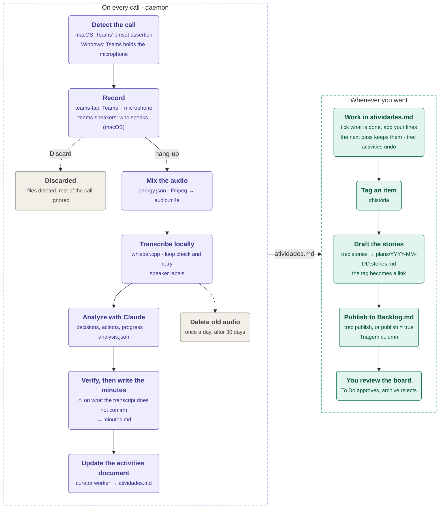

# teams-recorder

Records your Microsoft Teams calls, transcribes them on your Mac and keeps one up-to-date list of what you committed to, without taking notes.

A background daemon notices when a call starts, records Teams audio and your microphone, transcribes locally with whisper.cpp, and asks Claude for the decisions, actions and deadlines. After each meeting an agent updates a single document, `data/activities/atividades.md`, with everything still open for you. Tag an item `#história` and `trec stories` drafts a user story from it.

Built for one person in several meetings a day. Meetings are mostly in Brazilian Portuguese and sometimes in English: each meeting's language is detected before it is transcribed, and the minutes, the activities document and the stories are always in Portuguese (a literal quote keeps the language it was said in). Code, CLI and docs are in English. Runs on macOS; the Windows port is built but has not run on real hardware yet.

## How it works



1. **Detect and record.** The daemon starts recording 1–2 s after a call begins and stops about 5 s after hang-up. A dialog lets you discard it.
2. **Mix and transcribe.** The two tracks are aligned, cleaned and mixed, then transcribed by whisper.cpp. Audio never leaves the machine. On macOS lines can carry the speaker's name, read from the Teams window.
3. **Analyze.** Claude extracts the summary, decisions, your actions, other people's actions and deadlines, with the timestamp where each was said. A second call marks what the transcript does not confirm. The result is `minutes.md`.
4. **Curate.** An agent updates `atividades.md`. It suggests what is done, but only you tick items; your edits are kept and `trec activities undo` restores the last pass.
5. **Stories, on demand.** Items tagged `#história` become user stories or task cards, which you can publish to a local Backlog.md board.

There is no database: a meeting's state is the set of files in its folder, so any step can be re-run, and one failed meeting never blocks the others.

## Quick start (macOS)

You need macOS 14.2+, [Homebrew](https://brew.sh), the new Teams client and, for the analysis, either a Claude API key (about US$ 0.10 per hour of meeting) or a logged-in [Claude Code](https://claude.com/claude-code).

> Keep the project out of `~/Documents`, `~/Desktop`, `~/Downloads` and iCloud Drive: macOS blocks background processes there.

```bash
git clone https://github.com/felipmateus/meet-record.git ~/Projetos/teams-recorder
~/Projetos/teams-recorder/scripts/install.sh
```

The installer is idempotent. It installs ffmpeg and whisper.cpp, builds the native helpers, asks for your name and LLM provider, downloads the model and installs the daemon. Then:

1. Run `trec doctor` until everything is `ok`.
2. Grant **Microphone**, **Screen & System Audio Recording** and **Accessibility** in System Settings > Privacy & Security. Accessibility you add yourself: press **+** and choose the `native/teams-speakers/.build/release/teams-speakers` binary (granting your terminal or Python does not count).
3. Join a test call and run `trec daemon --once`. It should report Teams in a call.

Details, options, Windows and manual setup: [Installation](docs/guide/install.md).

## Daily use

Join Teams calls as usual. After each call:

- the minutes land in `data/recordings/<id>/minutes.md`;
- a few minutes later `atividades.md` is updated. Open it with `trec activities --open`, tick what is done and add your own lines;
- to get a user story, add `#história` to an item and run `trec stories`;
- after 30 days (`[audio] retention_days`) the daemon deletes the meeting's audio. Transcripts, minutes and the activities document are kept.

| Command | What it does |
|---|---|
| `trec status` | Every meeting and its state, the recording in progress, the activities summary |
| `trec activities [--open]` | Where the activities document stands; `--open` opens it |
| `trec activities undo` | Restores the document to before the last pass |
| `trec stories` / `trec publish` | Drafts stories from tagged items / sends them to the Backlog.md board |
| `trec start` / `trec stop` | Manual recording |
| `trec doctor` | Checks dependencies, models and permissions |
| `trec agent restart` | Run after changing `config.toml` or the code |

All commands: [Command reference](docs/guide/commands.md).

## Privacy

- Audio and transcription never leave your machine.
- Only text is sent to Claude, never audio: the transcript (with participants' display names and your name), the analyses, the activities document (your own lines included) and the prompts.
- Stories go to a local, git-ignored Backlog.md board.
- Telling participants you are recording, and following company policy and LGPD, is up to you.

## Documentation

| Guide | Covers |
|---|---|
| [Installation](docs/guide/install.md) | Prerequisites, macOS and Windows installers, manual setup, uninstall, first run checklist |
| [Command reference](docs/guide/commands.md) | Every `trec` command |
| [Recording and transcription](docs/guide/recording.md) | Manual recording, keep or discard, tracks and mixing, whisper and hallucination loops |
| [Speaker labels](docs/guide/speaker-labels.md) | How names are read from the Teams window and what it needs |
| [Analysis with Claude](docs/guide/analysis.md) | What is extracted, the minutes, safeguards, API vs. Claude Code |
| [Activities and stories](docs/guide/activities-and-stories.md) | The activities document, drafting stories, the Backlog.md board |
| [Configuration and data](docs/guide/configuration.md) | `config.toml`, environment variables, prompts, data layout, retention |
| [Troubleshooting](docs/guide/troubleshooting.md) | Common problems and fixes |
| [Development](docs/guide/development.md) | Tech stack, architecture, tests, conventions, project status |

Deeper material: [product requirements](docs/prd/README.md), [requirements and architecture](docs/REQUIREMENTS-AND-ARCHITECTURE.md), [speaker attribution research](docs/SPEAKER-ATTRIBUTION.md), specs in [`docs/tasks/`](docs/tasks/), [commit conventions](docs/COMMITS.md) and [`AGENTS.md`](AGENTS.md) for coding agents.

## License

MIT, as declared in `pyproject.toml`.
