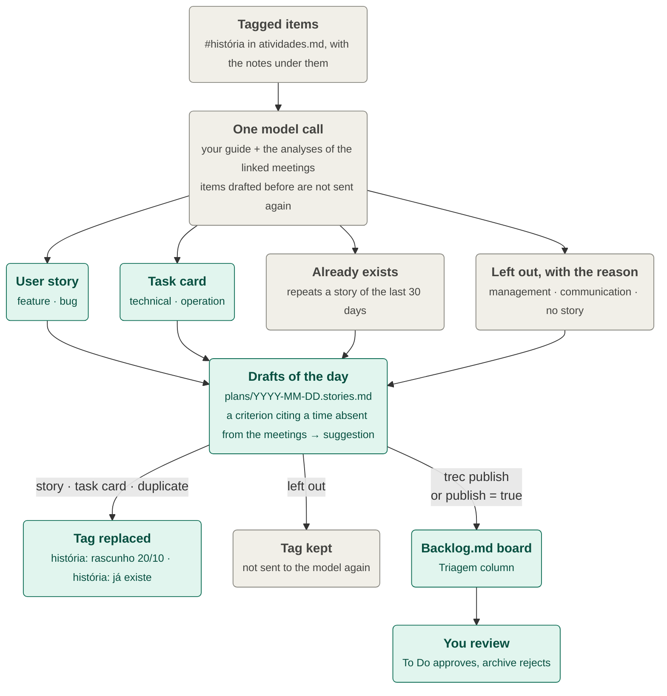

# Activities document and user stories

## Activities document

> This document replaced the daily plan: on 2026-10-20 the 6 pm planner and `trec plan` were removed. Old plans in `data/plans/` and `open_actions.json` stay on disk, unread.

After each analyzed meeting, one Claude call (the curator, `prompts/curate_system.md`) updates `data/activities/atividades.md`. It receives the current document, the new analyses, transcript excerpts around each progress statement, a 14-day calendar, what you edited since its last pass and the recent archive. It answers with edits to the file plus a focus, a one-line summary and whether to notify you. Up to four meetings that finished together are curated in one pass.

```bash
trec activities curate --since 2026-10-05   # once: build the document from past meetings (asks first)
trec activities --open                      # focus, counts, last pass, meetings not curated; opens the file
trec activities undo                        # restore the document to before the last pass
```

The document (in Brazilian Portuguese) has a box rewritten on every pass (update time and the three to five lines of focus), then `## Minhas ações`, `## Aguardando outros`, `## Agenda e prazos`, `## Contexto recente`, and a generated link block. Each item links to its meeting's `minutes.md`. Three markers: 💬 a suggestion about something a meeting said (never an automatic change), ⚠️ not confirmed, 💤 not mentioned for about three weeks.

- **Only you close an item.** A meeting that says something is done adds a 💬 sub-line with the quote; you tick it. The one code rule: only an archive (with a reason) removes a checkbox line, and no edit ticks or unticks one.
- **Your edits stand.** Lines you wrote or changed are never reworded, moved or archived; a meeting that mentions one adds a sub-line. A line you delete is archived as `removido por você`. A line you type inside the box is moved to the right section. Edits made while a pass runs are kept (the curator's edits are applied to the file as it is when the answer arrives) and are read at the next pass.
- **Nothing is deleted.** What leaves goes to `data/activities/arquivo/YYYY-MM.md` with its date and reason: items you ticked before the previous working day, past agenda entries, answered context lines, duplicates. Versions of the last 50 passes are kept for `trec activities undo`, which previews the change and asks first.
- **Failures are retried.** A failed pass leaves the document untouched, writes `curation_error.txt` in the meeting folder, notifies you and is retried by the daemon (at most twice for a meeting curated alone). `trec activities` lists every meeting analyzed in the last 10 working days with no successful pass and the command to rerun it.
- **Settings.** `[activities]` in `config.toml`: `enabled` (`false` turns off only the automatic updates; the `trec activities` commands still work), `model`, `cli_model`, `effort`, `notify`, `keep_versions`. The project and its `data/` must stay out of iCloud, Documents and Desktop, as for every file the daemon writes.

The daemon runs the curator in a thread, so it needs `trec agent restart` after this feature is installed. To get a user story from an item, tag it `#história` (see [User stories](#user-stories-and-the-backlogmd-board)). The file layout is under [Data layout](configuration.md#data-layout); the product page is [`docs/prd/pages/09-activities.md`](../prd/pages/09-activities.md).

## User stories and the Backlog.md board

### Drafting

Stories are drafted on demand, only for items you ask for. Add `#história` to an item of `data/activities/atividades.md` (the notes you write under it, indented, come with it), then run:

```bash
trec stories     # a draft for every tagged item → data/plans/YYYY-MM-DD.stories.md
```



- One model call writes the drafts of all the new tagged items, by the rules of your guide (`[stories] guide`, default `prompts/user_story_guide.md`). Edit that file to change how stories are written; it is re-read on every call. The call also sees the analyses of the meetings the items link to.
- The model sets each story's kind from the item: `feature` and `bug` become user stories, `technical` and `operation` become task cards with only the short title and details. Anything else (management, communication, a follow-up) is not drafted and is listed with a reason. It sets priority and due date only when the item or its meetings stated one.
- When it finishes, the tag is replaced by a link (`história: [rascunho 20/10](../plans/2026-10-20.stories.md)`), or by `história: já existe ("<title>")` when the item repeats a story of the previous `dedup_days` days (default 30). An item the model left out keeps its tag, and running `trec stories` again does not send it to the model a second time.
- The command never waits for a curator pass: if one is running, the tags are replaced by the next `trec stories`. A line you edited meanwhile keeps its tag. Running it with nothing tagged says so and calls no model.
- The code keeps traceability: a story may only cite an item it received, every item left out is listed with a reason, and a criterion that cites a time absent from the meetings becomes a suggestion.
- Drafts of one day are merged into one `plans/YYYY-MM-DD.stories.md`; the numbering of earlier stories does not change, so a day whose stories were already published can receive new ones (publishing skips what a board already has).

### Publishing

```bash
trec publish                               # today's drafts → the boards in [stories] destinations
trec publish --date 2026-10-09 --only 1,3  # a given day, only stories 1 and 3
backlog board                              # view the board in the terminal (or `backlog browser`)
```

Each story becomes a task in the **Triagem** column, with its acceptance criteria, priority, labels and where it came from. Move a task to To Do to approve it, or archive it to reject it. teams-recorder never edits a task after creating it. Publishing again never duplicates a task: each publication is saved in `plans/<day>.stories.json` as soon as it succeeds. With `[stories] publish = true`, stories are published right after drafting.

The board lives in `./backlog`, which is **git-ignored**, because stories carry meeting content and this repository is public. Publishing is refused when Git would version the board (or cannot confirm it is ignored), or when Backlog.md is configured to commit or reach remotes.

One-time setup:

```bash
brew install backlog-md                 # or: npm i -g backlog.md
```

```bash
backlog init "teams-recorder" --no-git --defaults --integration-mode none --auto-open-browser false
```

Then add `"Triagem"` to `statuses` in `backlog/config.yml` (for example, `statuses: ["Triagem", "To Do", "In Progress", "Done"]`) and check that `trec doctor` reports `story destination backlog-md: ready`. `--no-git` keeps Backlog.md from committing, and `--integration-mode none` keeps it from editing `AGENTS.md` and `CLAUDE.md`.
